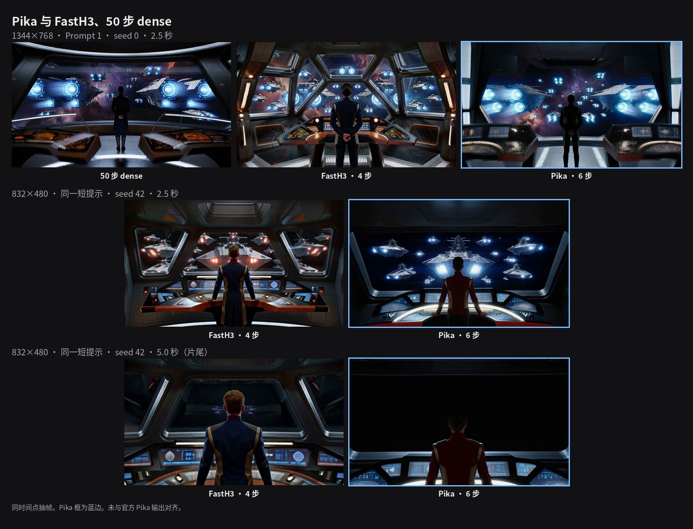

# Pika H3 Flex

Opt-in post-train of MiniMax-H3 from
[Pika-Labs/Pika-H3-Flex](https://huggingface.co/Pika-Labs/Pika-H3-Flex).
The text encoder, both VAEs, and the packed DiT stay the MiniMax-H3
checkpoint you already have. Two things change: a rank-128 LoRA merged
at load, and a fixed 6-step renoise sampler (timesteps 1000, 750, 500,
250, 100, 40; video shift 12, audio shift 3). It is off unless
`--pika-lora` or `--pika-ref-lora` is set, and it is not a `bench/`
scoreboard row.

Do not download that repo's copy of the base weights. Use
`FL2VA/` (and `Ref2VA/` when you pass references) from
[MiniMaxAI/MiniMax-H3](https://huggingface.co/MiniMaxAI/MiniMax-H3).
The adapter manifest pins base revision
`42ed227ee7df40d41602854ae760620d6eb651fe`.

## Download

```bash
pip install -U "huggingface_hub[cli]"
./tools/download_weights.sh --dir ./MiniMax-H3          # base, if you do not have it
export H3_MODEL=$PWD/MiniMax-H3
./tools/download_pika_lora.sh --dir ./Pika-H3-Flex      # FL2VA adapter, ~2.77 GB
./tools/download_pika_lora.sh --both --dir ./Pika-H3-Flex   # also the Ref2VA adapter
```

The script checks sha256:

| file | sha256 |
|---|---|
| `fl2va/adapter.safetensors` | `8ed6115d647ab11c1b38d04e63c4c6e1594128ae312f7b5635cd50563b7b9327` |
| `ref2va/adapter.safetensors` | `eef684ba1258f0cdbbbda6128188ad2688417f2eb17ff875375e74a32b6d61b5` |

Factors are FP32, rank 128, alpha 128 (scale 1). This tree converts
them to BF16 and merges with `W += B @ A` before the usual INT8
quantize. 624 tensors, names `lora_A.default.weight` /
`lora_B.default.weight`, on `to_q`, `to_k`, `to_v`, `to_out.0`,
`ff.net.0.proj`, and `ff.net.2`.

## Run

T2VA. `--pika-lora` forces the 6-step schedule, 50 layers, and
`--reuse 1`, and turns on the GPU Euler sampler unless `H3_GPU_SAMPLER`
or `H3_CPU_SAMPLER` is already set. `--steps` is ignored.

```bash
./h3 --profile -d "$H3_MODEL" \
  --pika-lora ./Pika-H3-Flex/fl2va/adapter.safetensors \
  -p "YOUR PROMPT" \
  --width 832 --height 480 --seconds 5 \
  --layers 50 --reuse 1 --seed 42 \
  -o outputs/pika.mp4
```

Faster decode, softer picture. Same latents, tiny video decoder:

```bash
./h3 --profile -d "$H3_MODEL" \
  --pika-lora ./Pika-H3-Flex/fl2va/adapter.safetensors \
  --taeh3 ./FastH3-4-step-LoRA/taeh3.safetensors \
  -p "YOUR PROMPT" \
  --width 832 --height 480 --seconds 5 \
  --layers 50 --reuse 1 --seed 42 \
  -o outputs/pika-taeh3.mp4
```

`--taeh3` comes from `./tools/download_taeh3.sh`. Audio still uses the
full audio VAE.

References use the Ref2VA transformer, so the FL2VA file is the wrong
adapter. Pass `--pika-ref-lora` together with a reference:

```bash
./h3 --profile -d "$H3_MODEL" \
  --pika-ref-lora ./Pika-H3-Flex/ref2va/adapter.safetensors \
  --ref-image reference.jpg \
  -p "YOUR PROMPT" \
  --width 832 --height 480 --seconds 5 \
  --layers 50 --reuse 1 --seed 42 \
  -o outputs/pika-ref.mp4
```

Rejected combinations: `--fasth3-lora`, `--token-reduction`,
`--sol-attn`, `--fbc`, `--vsa`, `--ssd-streaming`, `--reuse` above 1,
`--layers` other than 50, and core reuse above 1. `--serve` does not
expose these flags.

## Performance

One MI300X (gfx942), 2026-11-02. Warm page cache, default INT8, GPU
Euler sampler, 50 layers, `--reuse 1`. Process E2E is `/usr/bin/time`
until `h3: wrote`. Not measured on gfx1151 or gfx90a.

832×480 · 5 s, seed 42, the short starship prompt. FastH3 is the dense
4-step adapter on the same machine the same day.

| path | E2E | denoise | SDPA / linear | video decode | peak |
|---|---:|---:|---|---:|---:|
| FastH3 4-step | 30.62 s | 10.90 s | 6.08 / 3.93 s | VAE 9.66 s | 21.9 GiB |
| Pika 6-step | **34.97 s** | 16.543 s | 9.135 / 5.964 s | VAE 9.596 s | 21.9 GiB |
| Pika + TAEH3 | **28.68 s** | 16.565 s | 9.152 / 5.966 s | TAEH3 3.375 s | 21.9 GiB |

Per step, Pika denoise matches FastH3 (about 2.7 s). The extra time is
the two additional forwards. SDPA plus linear is the denoise wall.
Changing the MFMA tile (`H3_SDPA_CDNA_WAVES` / `H3_SDPA_CDNA_BK`) moved
this clip by at most 0.2 s; the default 8×32 stays.

1344×768 · 5 s, seed 0, Prompt 1 from the H3-OnDevice page. The dense
and FastH3 columns are the 2026-10-07 published rows
([`MI300X_VS_NVIDIA_768P_2026-10-07.md`](perf-runs/MI300X_VS_NVIDIA_768P_2026-10-07.md)),
not a same-binary rerun. Their FastH3 denoise is 49.87 s for 4 steps
(12.5 s/step). This Pika denoise is 75.3 s for 6 steps (12.6 s/step).

| path | E2E | denoise | SDPA / linear | video decode | peak |
|---|---:|---:|---|---:|---:|
| dense 50-step | 668.15 s | 623.543 s | 470.734 / 122.968 s | VAE 34.366 s | 28.614 GiB |
| FastH3 4-step | 96.51 s | 49.873 s | 37.689 / 9.794 s | VAE 34.245 s | 27.851 GiB |
| Pika 6-step | **120.10 s** | 75.323 s | 56.774 / 14.838 s | VAE 34.416 s | 27.946 GiB |
| Pika + TAEH3 | **93.54 s** | 75.118 s | 56.621 / 14.804 s | TAEH3 8.260 s | 27.946 GiB |

864×480 · 15 s, seed 42, the `bench/fox-15s.sh` prompt. Pika cannot
take that script's `--reuse 2`, `--layers 45`, or `--token-reduction`.
The published `fox-15s.sh` row (146.21 s) is that other recipe.

| path | E2E | denoise | SDPA / linear | video decode | peak |
|---|---:|---:|---|---:|---:|
| Pika 6-step | **137.53 s** | 98.609 s | 76.977 / 17.360 s | VAE 28.035 s | 29.628 GiB |
| Pika + TAEH3 | **119.49 s** | 98.475 s | 76.843 / 17.321 s | TAEH3 10.063 s | 29.628 GiB |

One Ref2VA smoke (832×480 · 5 s, a still reference) spent 144.8 s in
the existing video VAE encoder, then 17.6 s denoise and 9.7 s decode.
That encoder cost is not a Pika-sampler number.

## Quality

Same Pika latents, TAEH3 against the full video VAE:

| clip | PSNR | SSIM |
|---|---:|---:|
| 832×480 · 5 s | 32.01 dB | 0.944 |
| 1344×768 · 5 s | 31.58 dB | 0.937 |

The tiny decoder keeps the composition and is softer. Audio is
unchanged.

Pika, FastH3, and 50-step dense are different samples. Frame PSNR
between them is about 14 dB and is not a quality score. On Prompt 1 at
2.5 s, Pika and dense are both one observation window; FastH3 splits
the glass into hexagonal panes. On the short 832×480 prompt, seed 42,
the Pika ending has an empty window after the fleet leaves; the FastH3
ending still shows a jump flash.

Still (768p top row, 480p below) and the native-resolution triptych
(4032×768: dense, FastH3, Pika, no audio):

[](../assets/showcase/pika-vs-fasth3-dense-gfx942.jpg)

[pika-fasth3-dense-3way-gfx942.mp4](../assets/showcase/pika-fasth3-dense-3way-gfx942.mp4)

This is not a bit match of the official diffusers pipeline. Initial
latents still use the MiniMax two-generator seed, renoise noise is a
separate stream from that same seed, and the LoRA is merged in BF16
under the default INT8 DiT. Keyframe center-crop and the Ref2VA
resolution buckets are not implemented.
